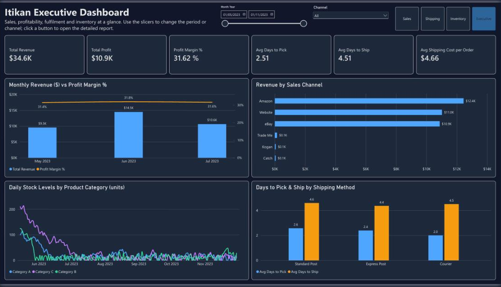
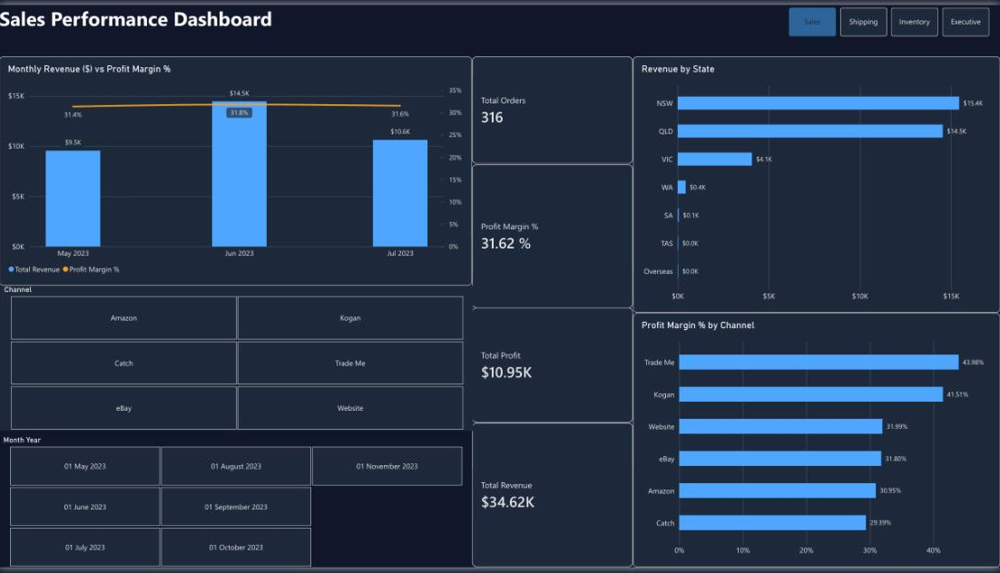
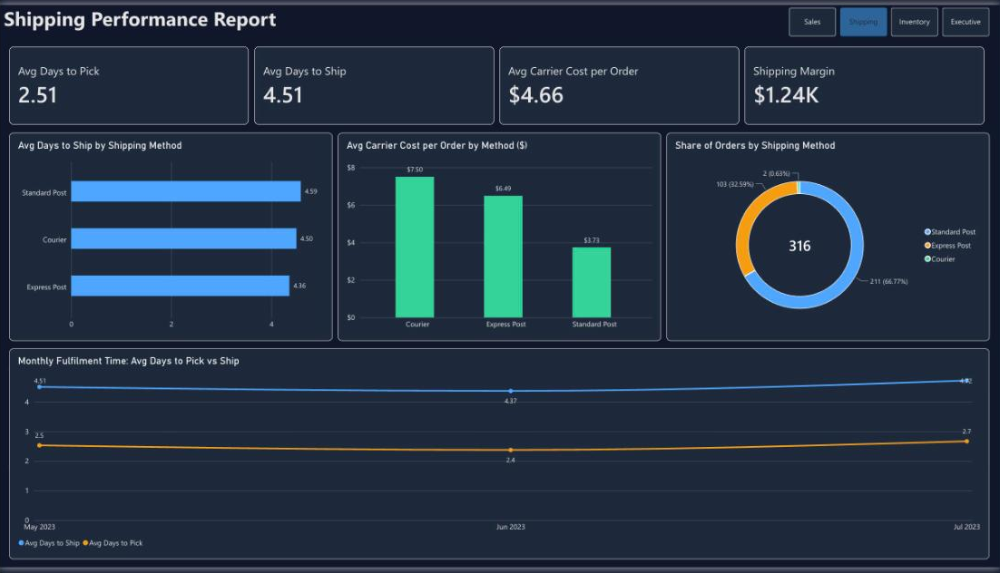
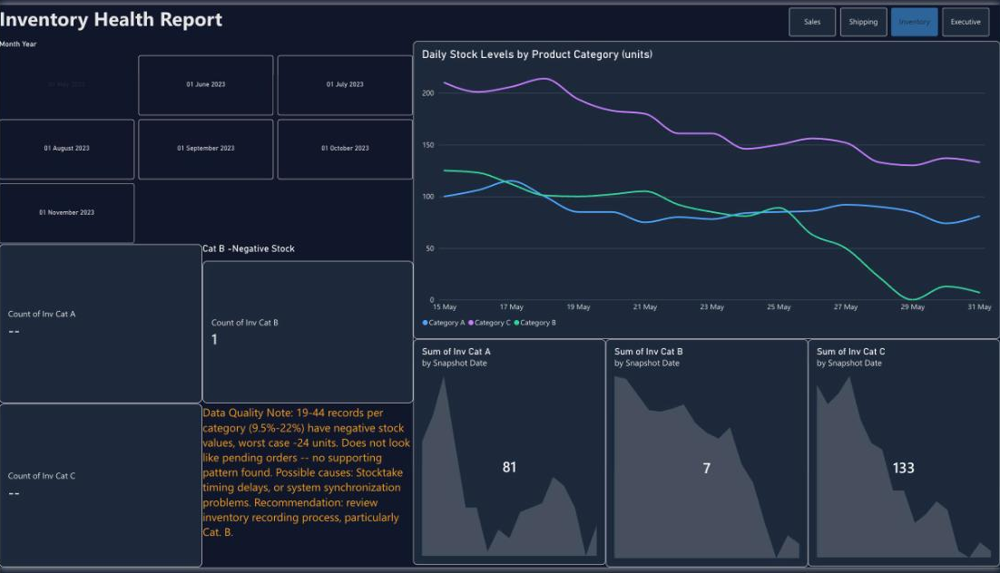

# Itikan Executive Dashboard: Power BI

An interactive Power BI dashboard for **Itikan**, an Australian eCommerce retailer that sells through Amazon, eBay, its own website and other marketplaces. The CEO was getting reports from each department in different formats. This dashboard brings **sales, profitability, fulfilment and inventory** together in one place, and he can drill down from a one-page executive view into a detailed report for each area.




## The business problem

The CEO looks after sales, inventory and distribution across Australia, and the company is planning to expand. He needed one place to answer:

- **Are we profitable, and is our pricing right?** He tracks the **profit percentage of each month's orders** as a check on product pricing.
- **Where do sales come from?** He wants the breakdown by channel and by state.
- **Is fulfilment running smoothly?** He watches picking time, shipping time and delivery costs.
- **Are stock levels healthy?** He needs to see stock-outs and data problems early.

## Approach: BI Dashboard Formula

| Step | What I did |
|------|------------|
| **1. Plan** | Defined the deliverable: one executive dashboard plus three drill-down reports, built in Power BI |
| **2. Scope** | Mapped each of the CEO's goals to a KPI: revenue, profit, profit margin %, order count, days to pick and ship, carrier cost, shipping margin, and stock level |
| **3. Design** | Chose visuals for each question: combo charts for trends, bar charts for comparisons, cards for headline KPIs and a donut chart for mix. Investigated data quality before building |
| **4. Develop & test** | Cleaned the data, built a star-style model with a shared date dimension, wrote the DAX measures, built 4 linked pages, and tested the slicers and navigation |
| **5. Launch** | Recorded a video walkthrough explaining the design choices and how the dashboard supports decisions |

## Report pages

### 1. Executive Dashboard
The one-screen snapshot. It has 6 KPI cards, revenue against margin by month, revenue by channel, stock levels and fulfilment time by shipping method. A **date-range slider** and a **Channel dropdown** filter everything on the page, and the buttons open the detailed reports.

### 2. Sales Performance

Monthly revenue against profit margin %, revenue by state, and profit margin by channel, with tile slicers for channel and month.

### 3. Shipping Performance

Average days to pick and ship, carrier cost per order, shipping margin, the shipping-method mix, and the monthly fulfilment trend.

### 4. Inventory Health

Daily stock levels for each product category, sparkline trends, and negative-stock counts, with a **data-quality note** that explains the anomalies to the CEO.

A PDF of all four pages is in [`report/itikan-dashboard-pages.pdf`](report/itikan-dashboard-pages.pdf).

## Key insights

- **Pricing is consistent.** Profit margin stayed at about **31–32% every month** (31.62% overall) while revenue moved between $9.5K and $14.5K. Margin held steady as volume changed.
- **Three channels carry the business.** Amazon ($12.4K), the Website ($11.0K) and eBay ($10.9K) bring in almost all revenue. Trade Me and Kogan have the **highest margins (44% and 42%)** but very little volume, so they could be worth growing.
- **Sales are concentrated by state.** NSW and QLD together account for about **86% of revenue**, while VIC, WA and SA are under-penetrated markets to consider for the expansion.
- **Faster shipping options aren't faster.** Express Post (4.4 days) and Courier (4.5 days) ship about as quickly as Standard Post (4.6 days), yet carrier costs are **$6.49 and $7.50 against $3.73**. Picking time (about 2.5 days) is the bigger bottleneck.
- **Inventory needs attention.** Category B stock fell to zero at the end of May, and **9.5–22% of inventory records show negative stock**. That points to stocktake timing or system sync problems, and I recommended a review of the inventory recording process.

## Data model


The model has four tables: `Sales_Clean`, `Shipping_Clean`, `Inventory_Clean` and a shared `Date_Dimension`. The date table filters both sales and inventory, so a single Month Year slicer controls every metric. The full table, relationship and visual breakdown is in [`docs/data-model.md`](docs/data-model.md).

### DAX measures

```dax
Total Revenue    = SUM ( Sales_Clean[Order Subtotal] )
Total Profit     = SUM ( Sales_Clean[Order Profit] )
Profit Pct       = DIVIDE ( [Total Profit], [Total Revenue], 0 )
Order Count      = DISTINCTCOUNT ( Sales_Clean[Order ID] )
Avg Days to Pick = AVERAGE ( Shipping_Clean[Days to pick] )
Avg Days to Ship = AVERAGE ( Shipping_Clean[Days to Ship] )
Shipping Margin  = SUM ( Sales_Clean[Shipping Revenue] ) - SUM ( Shipping_Clean[Shipping Cost (Carrier)] )
```

## Data preparation

The sample data (about 1% of orders, with names and order numbers anonymised) was cleaned before modelling:

- **Standardised states:** inconsistent state entries were normalised into `State_Clean`, with overseas orders grouped separately
- **Validated totals:** `Order Total (Check)` recalculates subtotal + tax + shipping to confirm the order totals
- **Calculated profit %** per order
- **Handled negative stock:** negative inventory values are flagged (`Flag Negative`), and a `Clipped` version floors them at zero so the charts stay meaningful while the issue stays visible
- **Added low-stock warnings** per category
- **Built a date dimension** (year, quarter, month, week, day of week) to support time intelligence

The Power Query (M) steps for each table are in [`/power-query`](power-query).

**Data that would add value:** product-level detail (SKU, cost price), customer IDs for repeat-purchase analysis, delivery dates (not just ship dates) to measure the full customer wait, and stock reorder points.

## Repository structure

```
├── README.md
├── images/          # Report page screenshots and data model
├── report/          # PDF export of all report pages
├── dax/             # DAX measures
├── power-query/     # Power Query (M) code for each table
└── docs/            # Data model, relationships and visual details
```

## Tools

Power BI (Service), DAX, Power Query (M), Excel

## Context

Built as an individual university assessment for a Bachelor of Information Technology at the University of the Sunshine Coast (UniSC). The brief was to design a CEO dashboard for a case-study company using the BI Dashboard Formula methodology. Itikan and its data are part of the case study, and customer details were anonymised.
