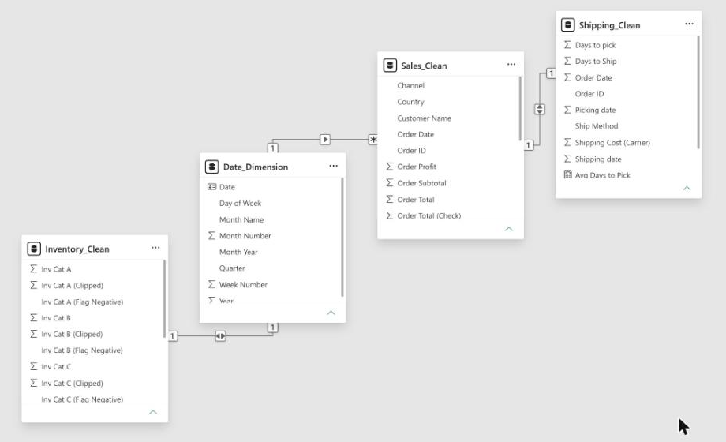

# Data Model & Report Structure

## Source

All four tables are loaded in import mode from one Excel workbook, `Itikan_Cleaned_Data_Pack.xlsx`. Each table comes from its own sheet. The data was cleaned and reshaped in Excel before it was loaded (see [Data preparation](../README.md#data-preparation)), and the Power Query steps then promote headers and set column types. The M code is in [`/power-query`](../power-query).

## Tables

| Table | Grain | Key columns |
|-------|-------|-------------|
| `Sales_Clean` | One row per order | Order ID, Order Date, Customer Name, Channel, State, State_Clean, Ship Method, Payment Method, Order Subtotal, Tax Total, Shipping Revenue, Order Total, Order Profit, Profit % |
| `Shipping_Clean` | One row per order | Order ID, Order Date, Picking date, Shipping date, Ship Method, Days to pick, Days to Ship, Shipping Cost (Carrier) |
| `Inventory_Clean` | One row per daily snapshot | Snapshot Date, Inv Cat A/B/C, Low Stock Cat A/B/C, Warning Cat A/B/C, Inv Cat A/B/C (Flag Negative), Inv Cat A/B/C (Clipped) |
| `Date_Dimension` | One row per day (marked as the date table) | Date, Year, Month Number, Month Name, Month Year, Quarter, Day of Week, Week Number |

## Relationships

| From | To | Cardinality | Cross-filter |
|------|----|-------------|--------------|
| `Date_Dimension[Date]` | `Sales_Clean[Order Date]` | 1 : * | Single |
| `Date_Dimension[Date]` | `Inventory_Clean[Snapshot Date]` | 1 : 1 | Both |
| `Sales_Clean[Order ID]` | `Shipping_Clean[Order ID]` | 1 : 1 | Both |

The shared `Date_Dimension` lets one **Month Year** slicer filter sales, fulfilment and inventory together. The 1:1 link on Order ID lets the **Channel** slicer flow through to the shipping metrics.

## Measures

See [`/dax/measures.dax`](../dax/measures.dax).

| Measure | Purpose |
|---------|---------|
| Total Revenue | Sum of order subtotals |
| Total Profit | Sum of order profit |
| Profit Pct | Profit ÷ revenue. This is the CEO's key pricing indicator |
| Order Count | Distinct orders |
| Avg Days to Pick | Average days from order to picking |
| Avg Days to Ship | Average days to ship |
| Shipping Margin | Shipping revenue charged minus carrier cost |

## Visuals by page

### Executive Dashboard
- Slicers: Month Year (date-range slider) and Channel (dropdown)
- 6 KPI cards: Total Revenue, Total Profit, Profit Margin %, Avg Days to Pick, Avg Days to Ship, Avg Shipping Cost per Order
- Line + column combo: Monthly Revenue vs Profit Margin %
- Bar chart: Revenue by Sales Channel
- Line chart: Daily Stock Levels by Product Category
- Clustered column chart: Days to Pick & Ship by Shipping Method

### Sales Performance
- Slicers: Channel and Month Year (tile style)
- 4 KPI cards: Total Orders, Profit Margin %, Total Profit, Total Revenue
- Line + column combo: Monthly Revenue vs Profit Margin %
- Bar charts: Revenue by State, Profit Margin % by Channel

### Shipping Performance
- 4 KPI cards: Avg Days to Pick, Avg Days to Ship, Avg Carrier Cost per Order, Shipping Margin
- Bar chart: Avg Days to Ship by Shipping Method
- Column chart: Avg Carrier Cost per Order by Method
- Donut chart: Share of Orders by Shipping Method
- Line chart: Monthly Fulfilment Time (pick vs ship)

### Inventory Health
- Slicer: Month Year (tile style)
- Line chart: Daily Stock Levels by Product Category
- Cards: negative-stock counts per category
- Area sparklines: stock trend for Category A, B and C
- Data-quality note on negative stock values

Every page has a navigation bar (Sales / Shipping / Inventory / Executive) so the CEO can drill down from the dashboard into each detailed report.
